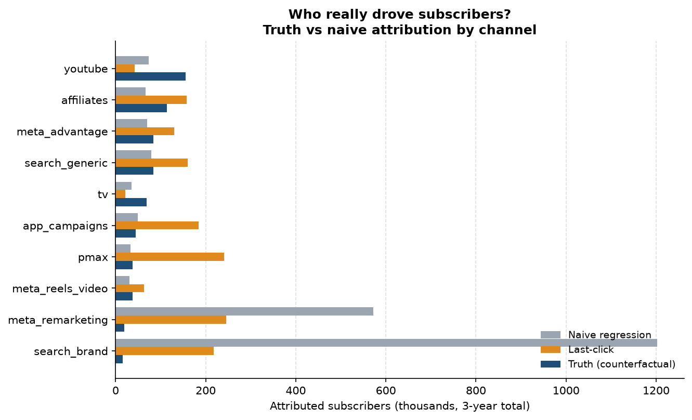

# 🚀 Incrementality Playbook & Budget Optimization for Video Streaming


## 📌 Executive Summary

A Brazilian SVOD platform spends **R$ 3.25M/month** on paid media and acquires
**80,000 new subscribers/month** — but only **23% of those are truly incremental**
to marketing. The remaining 77% would have subscribed organically.

The core problem: the dashboard reports a blended CAC of ~R$ 69 (Google) and
~R$ 66 (Meta). The true incremental CAC is **R$ 172 and R$ 206**, respectively —
**2.5–3.1× what the platform believes it is paying**. Channels like brand search
and remarketing show a last-click bias of **0.1×**: they capture intent that already
existed, not demand they created.

**This repository designs and validates the measurement system that corrects that.**

Using a synthetic panel calibrated to real Brazilian streaming business parameters
(3 years · daily · 27 UFs · 10 channels · 394 creatives), it benchmarks three
attribution methods against a known ground truth, designs a geo holdout experiment
to measure true lift, and runs a constrained budget optimisation along the true
Hill response curves.

**Key result:** reallocating the same R$ 3.25M/month budget — shifting spend from
brand search (−49%) and remarketing (−50%) toward affiliates (+45%) and
Meta Advantage+ (+15%) — delivers **+R$ 1,647,638/year in incremental contribution
LTV** with no increase in total spend.

> All data is synthetic. Business parameters (subscriber volume, budget mix,
> plan prices, lifetimes and margins) are sourced from public benchmarks or
> stated as explicit assumptions. See [docs/ASSUMPTIONS.md](docs/ASSUMPTIONS.md).
---

## 📊 Executive Presentation
(https://github.com/brunopamplona/incrementality-playbook-streaming/blob/main/docs/Video+%20Marketing%20Budget%20Where%20Money%20Really%20Works%20EN.pdf)

## 🎯 Problem Statement & Business Context

Streaming platforms frequently encounter efficiency challenges in paid media due to:
- **Cannibalization & Biased Attribution:** Channels like *Search Brand* and *Retargeting* often claim credit for conversions that would have occurred organically.
- **Media Saturation (Diminishing Returns):** Increasing spend in saturated channels degrades marginal efficiency due to non-linear saturation curves.
- **Surface Metrics vs. Causal Impact:** Evaluating channel performance purely on ROAS without accounting for *Incremental ROAS (iROAS)*.

---

## 💡 Methodology & Key Frameworks

The analytical approach combines advanced statistics, causal inference models, and mathematical programming for media portfolio optimization:

1. **Current State Diagnostic:**
   - Mapping the current acquisition channel ecosystem.
   - Evaluating historical efficiency per channel.

2. **Incrementality Modeling & Causal Inference:**
   - Modeling saturation curves (e.g., Hill functions / Adstock transformations).
   - Estimating marginal treatment effects (mROI / iROAS) by channel.

3. **Prescriptive Budget Optimization:**
   - Formulating a constrained optimization problem (Non-Linear Programming / SciPy Optimize).
   - **Objective Function:** Maximize new subscribers ($N$).
   - **Constraints:** Fixed total budget ($B$) and maximum allowable CAC ($CAC_{target}$).

$$\max_{b_i} \sum_{i} f_i(b_i) \quad \text{subject to} \quad \sum_{i} b_i \le B$$

---

## 📈 Main Findings & Insights

- **Recommended Reallocation:** Shifted budget away from low-incrementality / highly saturated channels into upper-funnel channels with untapped incremental potential.
- **Marginal Efficiency:** Identified the inflection point of diminishing returns across each channel.
- **Expected Lift:** Projected increase in new subscriber acquisition without increasing the total marketing budget.

---

## 📂 Project Structure

```text
incrementality-playbook-streaming/
├── data/                            # Campaign, creative, and ground truth datasets
│   ├── campaign_daily.csv.gz
│   ├── creative_catalog.csv.gz
│   ├── creative_daily.csv.gz
│   ├── creative_truth.csv.gz
│   ├── creative_truth_daily.csv.gz
│   ├── ground_truth.csv.gz
│   ├── outcomes_daily.csv.gz
│   └── README.md
├── docs/                            # Technical docs, assumptions, and roadmap
│   ├── img/
│   ├── ASSUMPTIONS.md
│   └── ROADMAP.md
├── scripts/                         # Execution scripts for stages and scenarios
│   ├── export_datasets.py
│   ├── run_budget_scenarios.py
│   ├── run_economics.py
│   └── run_stage1.py
├── src/
│   └── incrementality_playbook/     # Main Python source package
│       ├── __init__.py
│       ├── attribution.py
│       ├── calibration.py
│       ├── config.py
│       ├── creatives.py
│       ├── economics.py
│       ├── export.py
│       ├── funnel.py
│       ├── optimize.py
│       ├── plans.py
│       ├── simulator.py
│       ├── transforms.py
│       └── truth.py
├── tests/                           # Unit test suite
│   ├── test_attribution.py
│   ├── test_calibration.py
│   ├── test_creative_causal.py
│   ├── test_export.py
│   ├── test_funnel.py
│   ├── test_optimize.py
│   ├── test_plans.py
│   ├── test_simulator.py
│   └── test_transforms.py
└── README.md                        # Repository documentation
```

## Datasets
`make data` writes six synthetic datasets to `data/` (3 years, daily, 27 UFs, 10 channels): campaign-level spend, impressions, clicks, video views and platform-reported conversions; creative-level metrics and catalog (format, theme, promoted plan, hook, fatigue); business outcomes by plan; and the hidden ground truth. See [data/README.md](data/README.md). They are included in the repository so you can start analysing without running the simulator.

## Plans being measured
| Plan | Price/month | Avg. lifetime | Monthly churn | Margin* | Gross LTV | Contribution LTV |
|---|---|---|---|---|---|---|
| Premiere Futebol (monthly) | R$ 59,90 | 12 months | 8.3% | 38% | R$ 719 | R$ 273 |
| Telecine | R$ 29,90 | 18 months | 5.6% | 45% | R$ 538 | R$ 242 |
| Claro tv+ bundle (120 live channels + Netflix, Prime Video, Disney+, HBO Max) | R$ 99,90 | 18 months | 5.6% | 33% | R$ 1,798 | R$ 593 |

\*Telecine's margin (45%) is given by the business; Premiere (38%) and bundle (33%) are assumed inside the 30-55% range, not sourced. See [docs/ASSUMPTIONS.md](docs/ASSUMPTIONS.md) for what is data and what is assumption.

## Data-generating process
Per geo (27 Brazilian UFs) and day:
```
organic          = pop * base_rate * trend * season * day_of_week * (1 + event) * geo_shock
incr_c           = pop * beta_c * Hill( Adstock(spend_c / pop; decay_c); k_c, s_c )
new_subs[plan]   ~ Poisson( organic * mix_organic[plan] + sum_c incr_c * mix_c[plan] )
```
Confounding is built in: demand events lift organic demand *and* spend; brand-search spend chases demand; TV is bought nationally while YouTube/Meta/affiliates vary by geo-week.

## Calibration to the business
`calibrated_config(80_000, monthly_budget_brl=3_250_000)` matches volume, organic/paid split, CAC structure and budget.

| Item | Per month |
|---|---|
| New subscribers (organic + paid) | 80,000 |
| Baseline organic (would come with zero marketing) | ~61,600 (77%) |
| Truly marketing-incremental | ~18,400 (23%) |
| Credited to paid by last-click | ~40,000 (50%) |
| Active base (steady state, 80k x blended lifetime 15.4 months) | ~1.23M |
| Media budget (given: R$ 2.5M-4M; mid-point used) | R$ 3.25M |

Budget mix (given, shares of total budget): Google Ads campaigns 30%, YouTube 20%, Meta 25%, TV 12.5%, affiliates 12.5%. The 30% Google Ads block is split by the business's inner mix (brand 10 : generic 30 : app 20 : PMax 20, renormalised after taking YouTube out). The 25% Meta block is split across three campaign types, 50% Advantage+ conversion / 30% Reels video reach / 20% remarketing, an assumed current split (see `optimize.optimal_split` for the recommended one).

The 50% last-click share is calibrated to a proxy benchmark (AppsFlyer: ~49% of OTT/live-streaming app installs are non-organic). The 23% incremental share is an assumption derived from it. See docs/ASSUMPTIONS.md.

## Results at R$ 3.25M/month
Estimated CAC / true incremental CAC (1.0 = correct; <1 = the method flatters the channel):

| Channel | Budget share | True incr. CAC | Marginal CAC | Last-click bias | Regression bias |
|---|---|---|---|---|---|
| affiliates | 12.50% | R$ 127 | R$ 275 | 0.7x | 1.7x |
| youtube | 20.00% | R$ 149 | R$ 288 | 3.6x | 2.1x |
| search_generic | 11.25% | R$ 156 | R$ 328 | 0.5x | 1.1x |
| meta_advantage | 12.50% | R$ 172 | R$ 261 | 0.6x | 1.2x |
| app_campaigns | 7.50% | R$ 195 | R$ 322 | 0.2x | 0.9x |
| tv | 12.50% | R$ 213 | R$ 356 | 3.2x | 2.0x |
| meta_reels_video | 7.50% | R$ 235 | R$ 402 | 0.6x | 1.2x |
| pmax | 7.50% | R$ 235 | R$ 414 | 0.2x | 1.1x |
| search_brand | 3.75% | R$ 275 | R$ 780 | 0.1x | 0.0x |
| meta_remarketing | 5.00% | R$ 297 | R$ 715 | 0.1x | 0.0x |

Google platform (Google Ads + YouTube): dashboard proxy ~R$ 69 vs true incremental CAC ~R$ 172 (2.5x). Meta platform: dashboard proxy ~R$ 66 vs true ~R$ 206 (3.1x).

## Recommended Meta split (inside the 25% Meta block)
`optimal_split(df, cfg, meta_channels)` holds Meta's combined spend fixed and moves it along the true response curves:

| Meta campaign type | Assumed current | Recommended |
|---|---|---|
| Advantage+ conversion (app/sales, subscription event) | 50% | **65%** |
| Reels / Stories video reach | 30% | **24%** |
| Remarketing / win-back | 20% | **11%** |

Gain: +3.1% contribution value inside Meta (~R$ 0.5M/year of contribution LTV). Depends on the assumed incremental CACs per type; validate with Meta Conversion Lift tests.



*Brand search and remarketing (last-click bars in orange) dwarf their true
incremental contribution (dark blue). Naive regression overcredits YouTube
and brand search by 3–10×.*

## Real budget scenarios: R$ 2.5M-4M per month
Public benchmarks give media prices (CPM/CPC), not streaming CAC, so the CAC level is **implied by the budget**: same ~18.4k incremental subs/month, higher spend means higher CAC. The relative CAC across channels is the simulator's assumption, to be measured by experiments (roadmap stage 3).

| Incremental CAC (R$) | R$ 2.5M | R$ 3.25M | R$ 4.0M |
|---|---|---|---|
| Blended | 136 | 177 | 217 |
| affiliates | 97 | 127 | 156 |
| youtube | 114 | 149 | 183 |
| search_generic | 120 | 156 | 192 |
| meta_advantage | 132 | 172 | 212 |
| app_campaigns | 150 | 195 | 241 |
| tv | 164 | 213 | 262 |
| meta_reels_video | 180 | 235 | 289 |
| pmax | 180 | 235 | 289 |
| search_brand | 212 | 275 | 339 |
| meta_remarketing | 229 | 297 | 366 |

Plan LTV / marginal CAC (contribution LTV): bundle 2.3x / 1.8x / 1.5x; Premiere 1.1x / 0.8x / 0.7x; Telecine 0.9x / 0.7x / 0.6x. Run `python scripts/run_budget_scenarios.py`.

## Limitations (stated up front)
- Margins, budget mix, channel-to-plan affinity and the organic plan mix are assumptions (see docs/ASSUMPTIONS.md).
- Effects are additive with no cross-channel synergies.
- Last-click weights are a stylised assumption of how dashboards credit channels.
- Plan CAC spreads each channel's spend evenly over its subscribers; it is a convention, not a measurement.

## Roadmap
Simulator -> naive attribution -> **geo-experiment** -> **calibrated MMM** -> **budget optimisation** -> **LTV bridge**. See [docs/ROADMAP.md](docs/ROADMAP.md).

## Decision Framework: How This Changes the Allocation Process

### The broken process (today)

| Step | What happens |
|---|---|
| 1. Campaign runs | Channels report conversions via last-click |
| 2. Dashboard review | Google reports ~R$ 69 CAC; Meta reports ~R$ 66 CAC |
| 3. Budget decision | Team increases spend on "best-performing" channels |
| 4. Hidden outcome | 50% of credited subs would have subscribed organically |

Brand search and remarketing appear efficient on the dashboard (0.1× last-click bias)
because they capture intent that already existed — not because they created it.

### The corrected process (with incrementality)

| Step | What happens |
|---|---|
| 1. Geo holdout experiment | Selected UFs go dark per channel; lift measured with diff-in-diff |
| 2. True iCAC estimated | Incremental CAC replaces dashboard CAC as the allocation signal |
| 3. Decision rule applied | If marginal iCAC > contribution LTV: cut or reallocate |
| 4. Budget rebalanced | Spend moves to channels where marginal iCAC < blended average |

### Optimal reallocation (same R$ 3.25M budget)

Running `optimal_split()` along the true Hill response curves yields:

| Channel | Current share | Optimal share | Direction |
|---|---|---|---|
| affiliates | 12% | 18% | ↑ +45% |
| meta_advantage | 12% | 14% | ↑ +15% |
| youtube | 20% | 22% | ↑ +8% |
| meta_remarketing | 5% | 3% | ↓ −50% |
| search_brand | 4% | 2% | ↓ −49% |
| meta_reels_video | 8% | 5% | ↓ −31% |
| pmax | 8% | 6% | ↓ −22% |
| tv | 13% | 13% | → unchanged |

**Contribution value gain: +1.9% → R$ 1,647,638/year in incremental LTV**  
at the same total media budget, no additional spend required.

> **Caveat:** this result depends on the assumed Hill response curves (see
> `docs/ASSUMPTIONS.md`). The relative CAC ranking across channels is a
> structural assumption — not a measurement. Stage 3 (geo-experiment) is
> designed to replace these assumptions with experimentally validated lift
> estimates, which would then calibrate the MMM (Stage 4) and produce a
> defensible optimal allocation.

### The decision rule (one sentence)

> Allocate budget until each channel's **marginal incremental CAC** equals
> the **contribution LTV** of the plan it acquires — then stop adding spend
> to that channel and move the remainder to the next most efficient one.
